# Cloud Infrastructure & Kubernetes Platform

Автоматизированная облачная инфраструктура и платформа контейнеризации на базе **Yandex Cloud**, управляемая через **Terraform**, **Ansible** и **GitHub Actions**.

---

## Содержание

1. [Архитектура решения](#архитектура-решения)
2. [Подтверждающие материалы по этапам](#подтверждающие-материалы-по-этапам)
   - [Этап 1: Облачная инфраструктура и S3 Backend (Terraform)](#этап-1-облачная-инфраструктура-и-s3-backend-terraform)
   - [Этап 2: Kubernetes кластер (Ansible)](#этап-2-kubernetes-кластер-ansible)
   - [Этап 3: Тестовое приложение и Container Registry](#этап-3-тестовое-приложение-и-container-registry)
   - [Этап 4: Мониторинг и маршрутизация Ingress](#этап-4-мониторинг-и-маршрутизация-ingress)
   - [Этап 5: Автоматизация CI/CD](#этап-5-автоматизация-cicd)
3. [Доступ к сервисам](#доступ-к-сервисам)
4. [Инструкция по развертыванию с нуля (Quick Start)](#инструкция-по-развертыванию-с-нуля-quick-start)
5. [Удаление инфраструктуры](#удаление-инфраструктуры)

---

## Архитектура решения

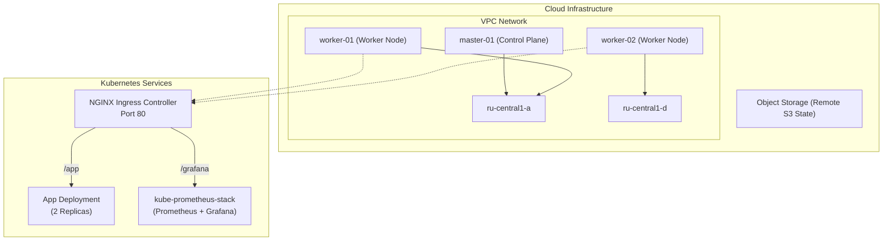

---

## Подтверждающие материалы по этапам

### Этап 1: Облачная инфраструктура и S3 Backend (Terraform)

- `terraform/bootstrap`: автоматическое создание сервисного аккаунта, статических ключей и S3 бакета для удаленного хранения стейта.
- `terraform/infra`: построение сети VPC, подсетей в 2 зонах доступности и 3 прерываемых ВМ Compute Cloud с экономичным профилем CPU (20% core_fraction).
- **Автогенерация инвентаря**: Terraform автоматически создает файл `ansible/inventory.ini` с актуальными IP-адресами.

**Скриншот 1.1** — S3 бакет и сервисный аккаунт в веб-консоли облака:

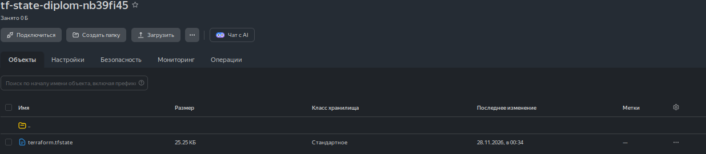

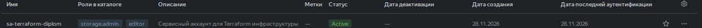

**Скриншот 1.2** — VPC с подсетями в разных зонах доступности:

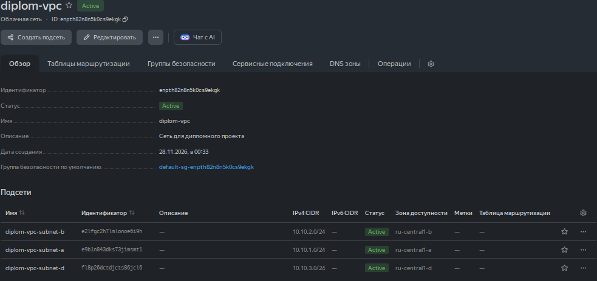

**Скриншот 1.3** — Вывод `terraform output` после применения инфраструктуры:

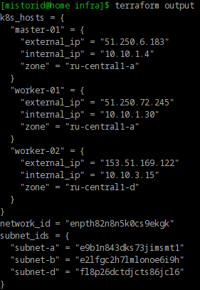

---

### Этап 2: Kubernetes кластер (Ansible)

Единый сценарий `ansible/site.yml`, разбитый на роли, выполняет полную установку под ключ:

1. `common` — настройка ядра (модули `overlay`, `br_netfilter`, sysctl, отключение swap), установка `containerd`, `kubeadm`, `kubelet`, `kubectl`.
2. `master` — инициализация control plane (`kubeadm init`), установка Flannel CNI.
3. `worker` — подключение узлов к кластеру (`kubeadm join`).
4. `addons` — установка Helm, NGINX Ingress Controller, деплой приложения и стека Prometheus+Grafana.

**Скриншот 2.1** — Статус узлов кластера (`Ready`):

```bash
export KUBECONFIG="ansible/kubeconfig.yaml"
kubectl get nodes -o wide
```

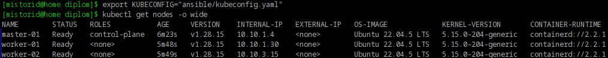

**Скриншот 2.2** — Список всех системных подов (`Running`):

```bash
export KUBECONFIG="ansible/kubeconfig.yaml"
kubectl get pods -A
```

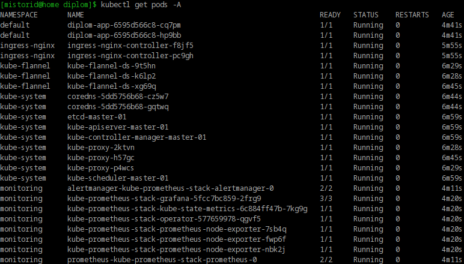

---

### Этап 3: Тестовое приложение и Container Registry

- Директория `app/`: веб-сервис на Nginx с healthcheck эндпоинтом `/healthz`.
- `Dockerfile`: легковесный alpine-образ.
- Публичный реестр Docker Hub: `https://hub.docker.com/r/mistorid1/diplom-app`

**Скриншот 3.1** — Страница репозитория в Docker Hub с тегами версий:

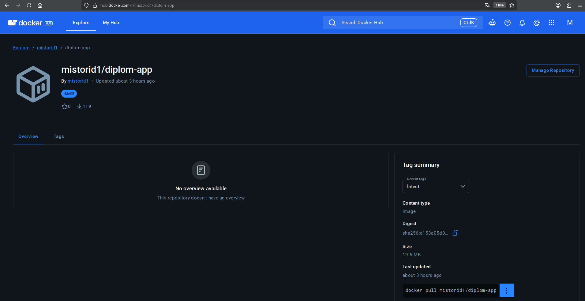

---

### Этап 4: Мониторинг и маршрутизация Ingress

В рамках роли `addons` автоматически разворачиваются:

1. **NGINX Ingress Controller** (DaemonSet, порт 80 на узлах).
2. Манифесты приложения из `k8s/app-deployment.yaml`.
3. Стек **kube-prometheus-stack** с настройками из `k8s/monitoring-values.yaml`.

Маршруты через порт 80:
- `/app` — тестовое приложение.
- `/grafana/` — панель мониторинга (логин `admin`, пароль `admin`).

**Скриншот 4.1** — Веб-интерфейс приложения в браузере:

`http://<ANY_WORKER_EXTERNAL_IP>/app`

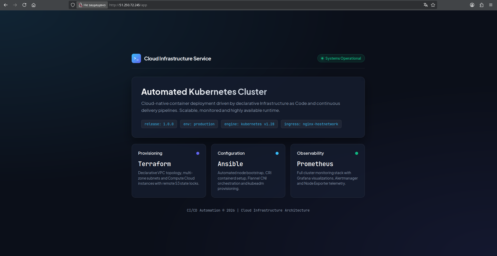

**Скриншот 4.2** — Окно авторизации Grafana:

`http://<ANY_WORKER_EXTERNAL_IP>/grafana/`

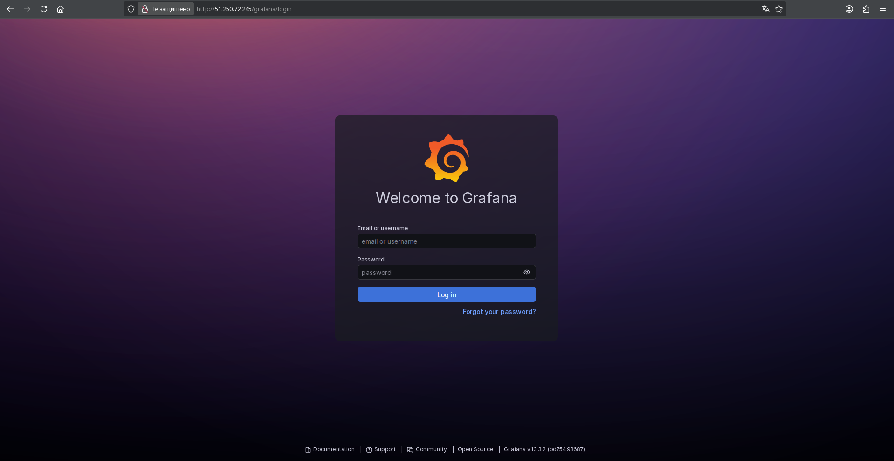

**Скриншот 4.3** — Дашборд состояния кластера в Grafana (`Kubernetes / Compute Resources / Cluster`):

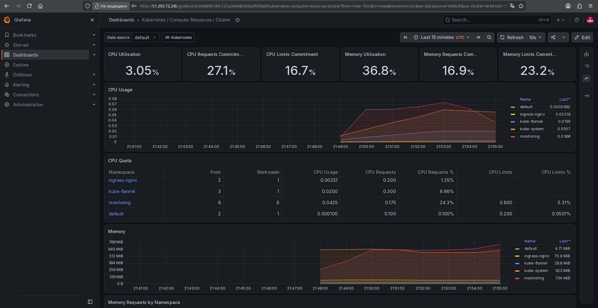

---

### Этап 5: Автоматизация CI/CD

**`.github/workflows/cicd.yml`** (Continuous Integration):

- Push в ветку `main`: сборка и публикация Docker-образа с коротким SHA-тегом и `latest`.
- Создание тега (`v1.0.1`, `v1.0.2`, ...): сборка и публикация образа с тегом релиза.

**`.github/workflows/terraform.yml`**:

- Pull Request в ветку `main`: проверка форматирования `terraform fmt` и валидация `terraform validate`.

**Декларативное управление релизами (GitOps)**:

Деплой новой версии выполняется обновлением поля `image` в `k8s/app-deployment.yaml` и применением манифеста через `kubectl apply`.

**Скриншот 5.1** — Выполнение CI/CD пайплайна в GitHub Actions:

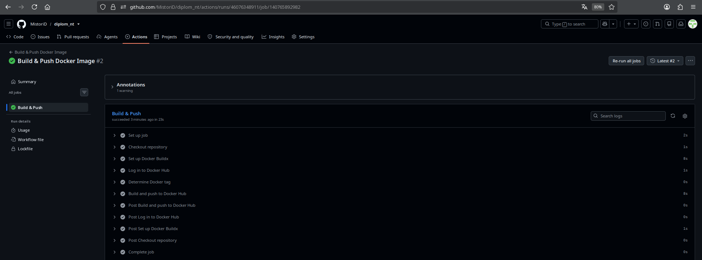

**Скриншот 5.2** — Pull Request с отчетом Terraform CI:

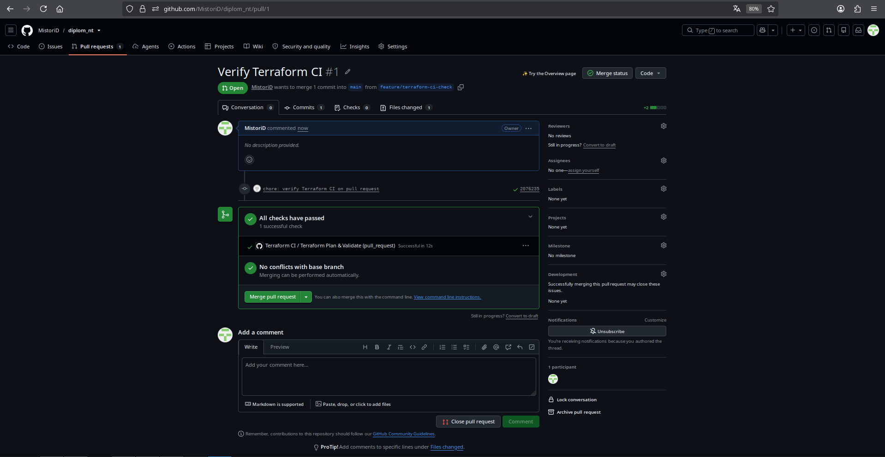

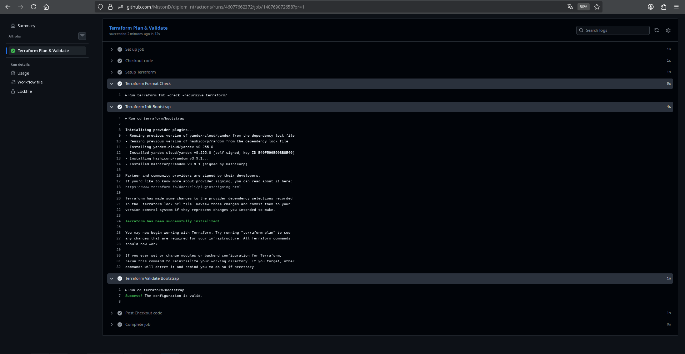

---

## Доступ к сервисам

Получить актуальные IP-адреса узлов:

```bash
cd terraform/infra && terraform output k8s_hosts
```

| Сервис | Маршрут | Учетные данные |
| :--- | :--- | :--- |
| Тестовое приложение | `http://<WORKER_IP>/app` | Без авторизации |
| Grafana | `http://<WORKER_IP>/grafana/` | `admin` / `admin` |
| Docker Hub | `https://hub.docker.com/r/mistorid1/diplom-app` | Публичный доступ |

`<WORKER_IP>` — внешний IP любой ноды `worker-01` или `worker-02`.

---

## Инструкция по развертыванию с нуля (Quick Start)

### Необходимые инструменты

- `terraform >= 1.5`, `ansible`, `kubectl`, `docker`
- Аккаунт Yandex Cloud (OAuth-токен, Cloud ID, Folder ID)
- Публичный SSH ключ `~/.ssh/id_rsa.pub`

### Шаги запуска

**1. Клонирование репозитория**

```bash
git clone <URL_РЕПОЗИТОРИЯ>
cd diplom
```

**2. Инициализация S3 Backend (bootstrap)**

```bash
cd terraform/bootstrap
cp terraform.tfvars.example terraform.tfvars
# Заполните terraform.tfvars своими значениями: yc_token, yc_cloud_id, yc_folder_id
terraform init
terraform apply -auto-approve
```

**3. Развертывание облачной инфраструктуры (infra)**

Получите параметры созданного S3 бакета из bootstrap:

```bash
# Находясь в terraform/bootstrap
echo "Bucket:     $(terraform output -raw s3_bucket_name)"
echo "Access Key: $(terraform output -raw access_key)"
echo "Secret Key: $(terraform output -raw secret_key)"
```

Перейдите в каталог `infra` и создайте файл `backend.hcl` с полученными значениями:

```bash
cd ../infra
cp backend.hcl.example backend.hcl
# Откройте backend.hcl и заполните bucket, access_key, secret_key
```

Содержимое `backend.hcl`:

```hcl
bucket     = "<ЗНАЧЕНИЕ_S3_BUCKET_NAME>"
access_key = "<ЗНАЧЕНИЕ_ACCESS_KEY>"
secret_key = "<ЗНАЧЕНИЕ_SECRET_KEY>"
```

Скопируйте `terraform.tfvars` и инициализируйте конфигурацию:

```bash
cp ../bootstrap/terraform.tfvars ./terraform.tfvars
terraform init -reconfigure -backend-config=backend.hcl
terraform apply -auto-approve
```

После выполнения Terraform автоматически сформирует файл `ansible/inventory.ini` с актуальными IP-адресами.

**4. Установка кластера и сервисов через Ansible**

```bash
cd ../../ansible
ansible-playbook site.yml
```

Сценарий выполняет всё под ключ: поднимает Kubernetes, устанавливает Helm, Ingress Controller, тестовое приложение и стек Prometheus+Grafana.

**5. Проверка состояния кластера**

```bash
export KUBECONFIG="$(pwd)/kubeconfig.yaml"
kubectl get nodes -o wide
kubectl get pods -A
```

**6. Декларативное обновление версии приложения**

Сборка образов автоматизирована через CI при создании тега. Для применения новой версии в кластере используется декларативный подход.

Шаг 6.1 — создать тег и запушить (CI соберёт и опубликует образ):

```bash
git tag v1.0.2
git push origin v1.0.2
```

Шаг 6.2 — обновить версию в манифесте `k8s/app-deployment.yaml`:

```yaml
containers:
- name: diplom-app
  image: mistorid1/diplom-app:v1.0.2
```

Шаг 6.3 — применить изменения в кластере:

```bash
export KUBECONFIG="$(pwd)/ansible/kubeconfig.yaml"
kubectl apply -f k8s/app-deployment.yaml
kubectl rollout status deployment/diplom-app
```

---

## Удаление инфраструктуры

Для полного освобождения облачных ресурсов выполните:

```bash
# 1. Удаление виртуальных машин и сетевой инфраструктуры
cd terraform/infra
terraform destroy -auto-approve

# 2. Удаление S3 бакета состояния и сервисного аккаунта
cd ../bootstrap
terraform destroy -auto-approve
```
