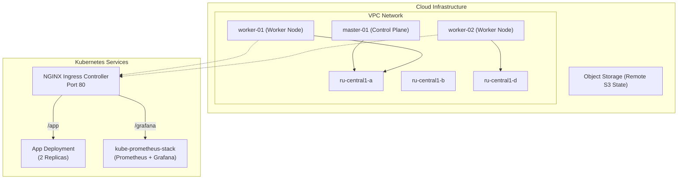

# Cloud Infrastructure & Kubernetes Platform

Автоматизированная облачная инфраструктура и платформа контейнеризации на базе **Yandex Cloud**, управляемая через **Terraform**, **Ansible** и **GitHub Actions**.

---

## 📑 Содержание

1. [Архитектура решения](#архитектура-решения)
2. [Подтверждающие материалы по этапам](#подтверждающие-материалы-по-этапам)
   - [Этап 1: Облачная инфраструктура и S3 Backend (Terraform)](#этап-1-облачная-инфраструктура-и-s3-backend-terraform)
   - [Этап 2: Kubernetes кластер (Ansible)](#этап-2-kubernetes-кластер-ansible)
   - [Этап 3: Тестовое приложение и Container Registry](#этап-3-тестовое-приложение-и-container-registry)
   - [Этап 4: Мониторинг и маршрутизация Ingress](#этап-4-мониторинг-и-маршрутизация-ingress)
   - [Этап 5: Автоматизация CI/CD](#этап-5-автоматизация-cicd)
3. [Доступ к сервисам](#доступ-к-сервисам)
4. [Инструкция по развертыванию с нуля (Quick Start)](#инструкция-по-развертыванию-с-нуля-quick-start)
5. [Удаление инфраструктуры (Очистка ресурсов)](#удаление-инфраструктуры-очистка-ресурсов)

---

## Архитектура решения



---

## Подтверждающие материалы по этапам

### Этап 1: Облачная инфраструктура и S3 Backend (Terraform)

- `terraform/bootstrap`: автоматическое создание сервисного аккаунта, статических ключей и S3 бакета для удаленного хранения стейта.
- `terraform/infra`: построение сети VPC, подсетей в 3 зонах доступности и 3 прерываемых ВМ Compute Cloud с экономичным профилем CPU (20% core_fraction).
- **Автогенерация инвентаря**: Terraform автоматически создает и наполняет актуальными IP-адресами файл `ansible/inventory.ini`.

> 📷 **Скриншот 1.1**: S3 бакет и сервисный аккаунт в веб-консоли облака.  
> ``

> 📷 **Скриншот 1.2**: Вывод команды `terraform output` после применения инфраструктуры:  
> ```bash
> cd terraform/infra && terraform output
> ```  
> ``

---

### Этап 2: Kubernetes кластер (Ansible)

- Единый сценарий `ansible/site.yml` полностью под ключ:
  1. Настраивает модули ядра (`overlay`, `br_netfilter`), sysctl и отключает swap.
  2. Устанавливает CRI `containerd` и утилиты `kubeadm`, `kubelet`, `kubectl`.
  3. Инициализирует master-узел и подключает worker-ноды.
  4. Развертывает сетевой плагин **Flannel CNI**.
  5. Скачивает готовый файл `kubeconfig.yaml` на хост.

> 📷 **Скриншот 2.1**: Статус узлов кластера (`Ready`):  
> ```bash
> export KUBECONFIG="ansible/kubeconfig.yaml"
> kubectl get nodes -o wide
> ```  
> ``

> 📷 **Скриншот 2.2**: Список всех системных подов (`Running`):  
> ```bash
> export KUBECONFIG="ansible/kubeconfig.yaml"
> kubectl get pods -A
> ```  
> ``

---

### Этап 3: Тестовое приложение и Container Registry

- Директория `app/`: современный веб-сервис на Nginx с healthcheck эндпоинтом `/healthz` и динамическим бейджем версии.
- `Dockerfile`: легковесный alpine-образ.
- Публичный реестр Docker Hub:  
  🔗 **Ссылка на образ**: `https://hub.docker.com/r/mistorid1/diplom-app`

> 📷 **Скриншот 3.1**: Страница репозитория в Docker Hub с тегами версий.  
> ``

---

### Этап 4: Мониторинг и маршрутизация Ingress

- В рамках общего сценария Ansible на мастере устанавливается **Helm** и автоматически развертываются:
  1. **NGINX Ingress Controller** (DaemonSet на 80 порту узлов).
  2. Манифесты приложения из `k8s/app-deployment.yaml`.
  3. Стек **kube-prometheus-stack** с настройками из `k8s/monitoring-values.yaml`.
- Все сервисы маршрутизируются через 80 порт:
  - `/app` — доступ к веб-приложению.
  - `/grafana/` — доступ к панели мониторинга (логин `admin`, пароль `admin`).

> 📷 **Скриншот 4.1**: Веб-интерфейс приложения в браузере (порт 80):  
> `http://<ANY_WORKER_EXTERNAL_IP>/app`  
> ``

> 📷 **Скриншот 4.2**: Окно авторизации Grafana (порт 80):  
> `http://<ANY_WORKER_EXTERNAL_IP>/grafana/`  
> ``

> 📷 **Скриншот 4.3**: Дашборд состояния кластера в Grafana (`Kubernetes / Compute Resources / Cluster`):  
> ``

---

### Этап 5: Автоматизация CI/CD

- **`.github/workflows/cicd.yml`** (Continuous Integration):
  - Push в ветку `main`: сборка и публикация Docker-образа в Docker Hub с коротким SHA-тегом и `latest`.
  - Создание тега (например, `v1.0.1`): автоматическая сборка и публикация образа с тегом релиза (`mistorid1/diplom-app:v1.0.1`).
- **Декларативное управление релизами (GitOps подход)**:
  - Версионирование инфраструктуры и приложений полностью контролируется через код манифестов.
  - Деплой новой версии выполняется декларативным обновлением поля `image` в манифесте `k8s/app-deployment.yaml`.
- **`.github/workflows/terraform.yml`**:
  - Pull Request: проверка форматирования `terraform fmt` и валидация конфигурации `terraform validate`.

> 📷 **Скриншот 5.1**: Выполнение CI/CD пайплайна в GitHub Actions.  
> ``

> 📷 **Скриншот 5.2**: Pull Request с отчетом Terraform CI.  
> ``

---

## Доступ к сервисам

Для получения актуальных IP-адресов выполните:
```bash
cd terraform/infra && terraform output k8s_hosts
```

| Сервис | Маршрут | Учетные данные |
| :--- | :--- | :--- |
| **Тестовое приложение** | `http://<WORKER_IP>/app` | Без авторизации |
| **Grafana** | `http://<WORKER_IP>/grafana/` | `admin` / `admin` |
| **Docker Hub** | `https://hub.docker.com/r/mistorid1/diplom-app` | Публичный доступ |

*(В качестве `<WORKER_IP>` можно использовать внешний IP любой ноды `worker-01` или `worker-02`).*

---

## Инструкция по развертыванию с нуля (Quick Start)

### Необходимые инструменты:
- `terraform (>= 1.5)`, `ansible`, `kubectl`, `docker`.
- Аккаунт Yandex Cloud (OAuth-токен, Cloud ID, Folder ID).
- Публичный SSH ключ `~/.ssh/id_rsa.pub`.

### Шаги запуска:

1. **Клонирование репозитория**:
   ```bash
   git clone <URL_РЕПОЗИТОРИЯ>
   cd diplom
   ```

2. **Инициализация S3 Backend (bootstrap)**:
   ```bash
   cd terraform/bootstrap
   cp terraform.tfvars.example terraform.tfvars
   # Укажите в terraform.tfvars: yc_token, yc_cloud_id, yc_folder_id
   terraform init
   terraform apply -auto-approve
   ```

3. **Развертывание облачной инфраструктуры (infra)**:
   - Получите параметры созданного S3 бакета из bootstrap (значения ключей скрыты, так как они `sensitive`):
     ```bash
     cd ../bootstrap
     terraform output -json
     ```
     *Или по отдельности в открытом виде:*
     ```bash
     echo "Bucket:     $(terraform output -raw s3_bucket_name)"
     echo "Access Key: $(terraform output -raw access_key)"
     echo "Secret Key: $(terraform output -raw secret_key)"
     ```
   - Перейдите в каталог `infra` и скопируйте `terraform.tfvars`:
     ```bash
     cd ../infra
     cp ../bootstrap/terraform.tfvars ./terraform.tfvars
     ```
   - В файле `providers.tf` в блоке `backend "s3"` подставьте полученные `bucket`, `access_key` и `secret_key`:
     ```hcl
     backend "s3" {
       endpoints = {
         s3 = "https://storage.yandexcloud.net"
       }
       bucket                      = "<ЗНАЧЕНИЕ_S3_BUCKET_NAME>"
       region                      = "ru-central1"
       key                         = "infra/terraform.tfstate"
       access_key                  = "<ЗНАЧЕНИЕ_ACCESS_KEY>"
       secret_key                  = "<ЗНАЧЕНИЕ_SECRET_KEY>"
       skip_region_validation      = true
       skip_credentials_validation = true
       skip_requesting_account_id  = true
       skip_s3_checksum            = true
     }
     ```
   - Инициализируйте и примените конфигурацию:
     ```bash
     terraform init -reconfigure
     terraform apply -auto-approve
     ```
   > ℹ️ *После выполнения команды Terraform автоматически сформирует файл `ansible/inventory.ini` со всеми новыми IP-адресами!*

4. **Полная установка кластера, мониторинга и сервисов через Ansible**:
   ```bash
   cd ../../ansible
   ansible-playbook site.yml
   ```
   > 🚀 *Этот сценарий выполняет всё под ключ: поднимает Kubernetes, ставит Helm, Ingress Controller, тестовое приложение и стек Prometheus+Grafana! Ручных действий больше не требуется.*

5. **Проверка состояния кластера**:
   ```bash
   export KUBECONFIG="$(pwd)/kubeconfig.yaml"
   kubectl get nodes -o wide
   kubectl get pods -A
   ```

6. **Декларативное обновление версии приложения**:
   Сборка образов полностью автоматизирована через CI при создании тега или пуше. Для применения новой версии в кластере используется декларативный подход через манифест:

   1. **Создание новой версии образа (через Git-тег)**:
      ```bash
      git tag v1.0.2
      git push origin v1.0.2
      ```
      *GitHub Actions автоматически соберет и опубликует образ `mistorid1/diplom-app:v1.0.2` в Docker Hub.*

   2. **Обновление версии в манифесте**:
      В файле `k8s/app-deployment.yaml` укажите новую версию:
      ```yaml
      spec:
        template:
          spec:
            containers:
            - name: diplom-app
              image: mistorid1/diplom-app:v1.0.2
      ```

   3. **Применение изменений в кластере**:
      ```bash
      export KUBECONFIG="$(pwd)/ansible/kubeconfig.yaml"
      kubectl apply -f k8s/app-deployment.yaml
      kubectl rollout status deployment/diplom-app
      ```

---

## Удаление инфраструктуры (Очистка ресурсов)

Для полного освобождения облачных ресурсов и остановки тарификации выполните:

```bash
# 1. Удаление виртуальных машин и сетевой инфраструктуры
cd terraform/infra
terraform destroy -auto-approve

# 2. Удаление S3 бакета состояния и сервисного аккаунта
cd ../bootstrap
terraform destroy -auto-approve
```
Все ресурсы в облаке будут гарантированно и полностью удалены.
